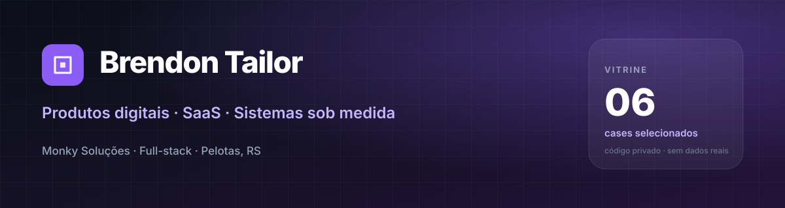
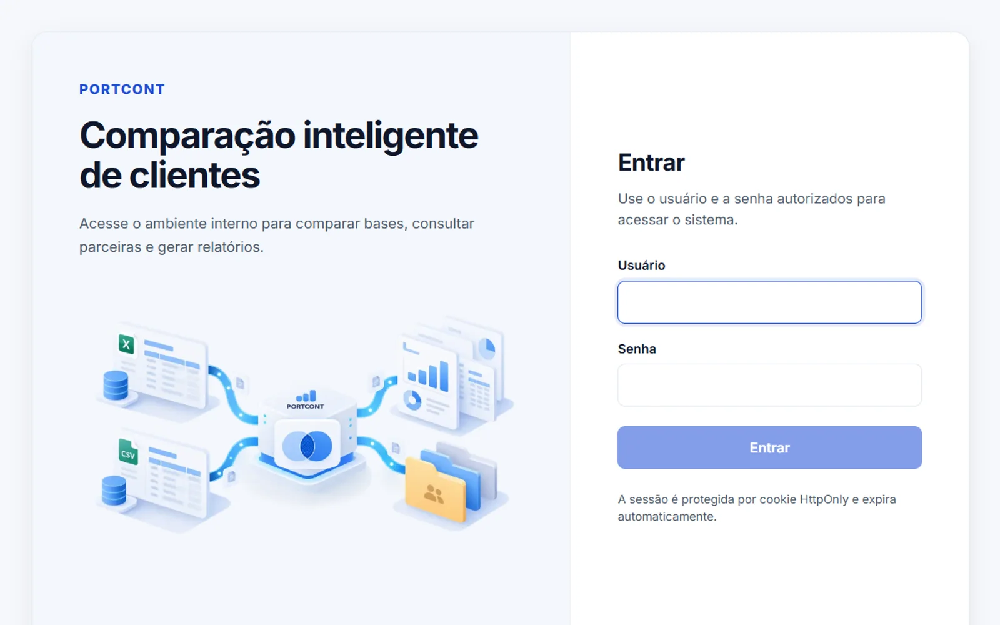
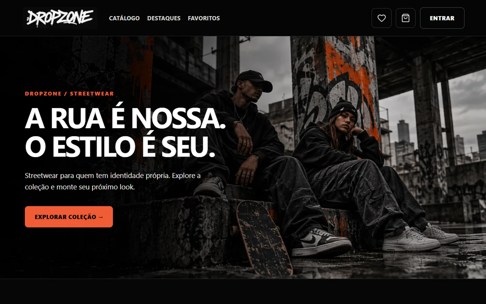

  

# Vitrine de projetos

Sou **Brendon Tailor**, desenvolvedor full-stack e co-fundador da **Monky Soluções**. Construo produtos digitais, SaaS e sistemas sob medida para operações reais.

Esta é uma vitrine selecionada de projetos que desenvolvi ou nos quais colaborei. O código é privado; aqui estão o contexto, a solução, a stack e o que eu fiz em cada case. Nenhum dado de cliente, credencial ou código-fonte está exposto.

---

## Cases

<table>
  <tr>
    <td width="50%" valign="top">
      
      <h3>Sah Açaí &amp; Cia</h3>
      
Sistema de pedidos pelo WhatsApp e painel financeiro para uma loja real.

      
<code>Cliente real</code> · <code>Food retail</code>

    </td>
    <td width="50%" valign="top">
      
      <h3>Monky Food</h3>
      
SaaS multi-tenant para lojas de comida, com a Sah Açaí como primeira operação.

      
<code>Produto próprio</code> · <code>SaaS</code>

    </td>
  </tr>
  <tr>
    <td width="50%" valign="top">
      
      <h3>Monky Tech</h3>
      
Gestão para lojas de eletrônicos e capinhas: PDV, estoque, financeiro e auditoria.

      
<code>Produto próprio</code> · <code>SaaS</code>

    </td>
    <td width="50%" valign="top">
      
      <h3>RoutePilot</h3>
      
Mapa operacional e planejamento de rotas para equipes de visitas técnicas.

      
<code>Produto próprio</code> · <code>PWA</code>

    </td>
  </tr>
  <tr>
    <td width="50%" valign="top">
      
      <h3>PortCont</h3>
      
Comparação inteligente de bases de clientes em PDF, Excel e CSV.

      
<code>Produto próprio</code> · <code>Dados</code>

    </td>
    <td width="50%" valign="top">
      
      <h3>Dropzone</h3>
      
E-commerce de streetwear, em colaboração com Leonardo Rosler.

      
<code>Colaboração</code> · <code>E-commerce</code>

    </td>
  </tr>
</table>

**Mais cases em breve.** Novos produtos e sistemas entram aqui conforme podem ser apresentados publicamente.

---

## Como esta vitrine funciona

- **Sem código-fonte:** os repositórios dos produtos são privados.
- **Sem dados reais:** capturas e descrições não expõem clientes, credenciais, bancos ou informações internas.
- **Com imagens reais:** fotos dos produtos e capturas das interfaces, sem capas genéricas nem watermarks.
- **Com autoria clara:** cada case informa o contexto, o que foi feito, a stack e o status.
- **Com curadoria:** um case por produto ou frente relevante, sem repetir a mesma solução.

## O que eu faço

- Produtos **SaaS multi-tenant**, com isolamento por empresa e operação white-label.
- Sistemas de gestão: **PDV, estoque, compras, financeiro, relatórios e permissões**.
- Aplicações web full-stack, APIs REST e integrações.
- **PWAs** e ferramentas operacionais com mapa, busca e uso offline.
- Protótipos e produtos digitais do zero, da modelagem ao deploy.

## Stack principal

## Sobre

Sou co-fundador da **Monky Soluções**, empresa focada em produtos digitais, SaaS e automação para negócios. Também colaboro com o Leonardo Rosler em projetos de produto e e-commerce.

- GitHub: [@Brendontailor](https://github.com/Brendontailor)
- LinkedIn: [brendon-tailor](https://www.linkedin.com/in/brendon-tailor-404144284)
- Cases com acesso restrito são apresentados apenas com autorização e sem dados sensíveis.

---

<strong>English summary</strong>

I'm a full-stack developer and co-founder of **Monky Soluções**. I build digital products, multi-tenant SaaS and custom systems for real businesses.

This repository is a curated portfolio. Source code is private; each case describes the problem, the solution, the stack and my role. No client data, credentials or source code are exposed.

**Selected work:** Sah Açaí (WhatsApp ordering + financial dashboard), Monky Food (food-service SaaS), Monky Tech (retail management SaaS), RoutePilot (field-service mapping PWA), PortCont (client-base comparison) and Dropzone (streetwear e-commerce collaboration).

