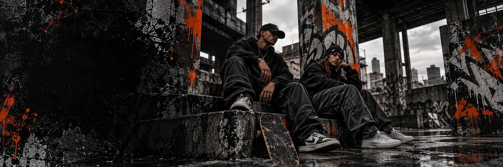

# Dropzone

**E-commerce de streetwear**  
`Colaboração` · `E-commerce` · 2026

## Contexto

A Dropzone é uma marca de streetwear com vitrine, catálogo, carrinho, favoritos e área administrativa. O projeto foi desenvolvido em colaboração com **Leonardo Rosler**.

## Meu papel

Atuei no frontend da vitrine e na integração com o backend, incluindo catálogo, carrinho, favoritos e login. Também contribuí em módulos de backend para autenticação, administração, avaliações, WhatsApp e recursos de IA.

## O que foi feito

- Vitrine e catálogo com filtros.
- Looks editoriais e galeria de produto.
- Carrinho e favoritos.
- Login de cliente.
- Integração do frontend com a API.
- Módulos de autenticação e administração.
- Avaliações de produtos.
- Integração com WhatsApp.
- Recursos de IA para apoio à experiência da loja.

## Stack

- **Frontend:** React 19, Vite e TypeScript.
- **Backend:** Node.js, Express 5, Prisma 7 e PostgreSQL.
- **Outros:** JWT, Zod, Sharp, Google GenAI e upload de imagens.

## Créditos

Projeto colaborativo. A marca, o catálogo e o código pertencem aos responsáveis pelo projeto. Este case é apresentado com crédito e sem exposição de dados de clientes.
