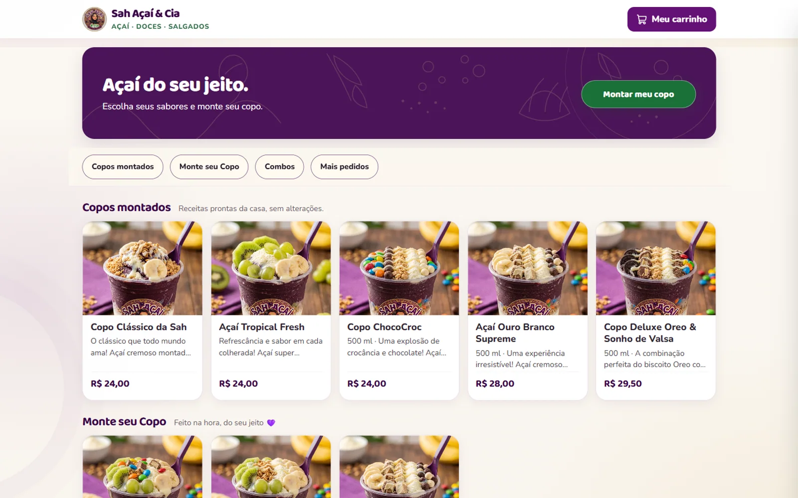

# Monky Food

**SaaS multi-tenant para lojas de comida**  
`Produto próprio` · `SaaS` · `Em desenvolvimento` · 2026

*Primeira operação real da plataforma: a vitrine da Sah Açaí & Cia, com catálogo, montagem de copo e checkout pelo WhatsApp.*

*Painel administrativo da primeira operação. Cada loja mantém sua própria identidade e seus dados isolados.*

## Contexto

Depois de colocar o sistema da Sah Açaí em operação, a próxima etapa foi transformar a mesma base em um produto reutilizável. A ideia é atender qualquer loja de comida — açaiterias, hamburguerias, pizzarias, marmitarias e operações de balcão — sem duplicar código nem misturar dados.

## Solução

Uma plataforma white-label em que cada loja tem seus dados isolados por empresa. A vitrine resolve a loja pelo domínio ou subdomínio, o painel central atende a operação e a primeira loja real é a Sah Açaí.

## O que foi feito

- Fundação multi-tenant com `empresaId` obrigatório nas tabelas de negócio.
- Resolução da loja por `Host` na vitrine e por sessão no painel.
- Catálogo, categorias, complementos, pedidos e financeiro por empresa.
- Configurações por loja e por plataforma.
- Caminho de migração para levar a operação que já existia.
- Evolução prevista para planos, módulos e identidade visual por loja.

## Stack

- **Frontend:** React, TypeScript, Vite e Tailwind.
- **Backend:** Node.js, Express, TypeScript e Prisma.
- **Banco:** PostgreSQL.
- **Arquitetura:** multi-tenant com banco compartilhado e isolamento por empresa.

## Status

Base multi-tenant em evolução. A Sah Açaí é a primeira operação da plataforma. O código é privado.
