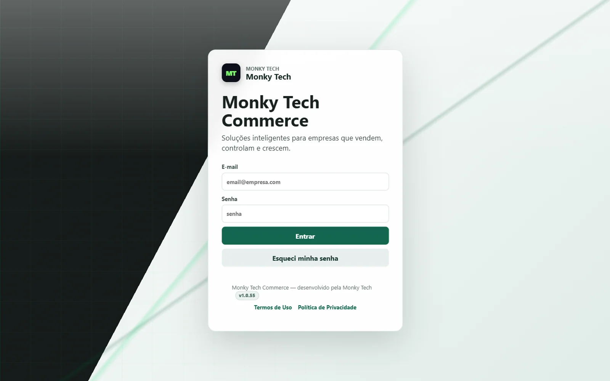

# Monky Tech

**SaaS de gestão para lojas de eletrônicos e capinhas**  
`Produto próprio` · `SaaS` · `Em evolução` · 2026

*Captura da interface real de acesso. A identidade visual está em transição de Orakyn para Monky Tech; o deploy legado ainda pode exibir o nome anterior.*

## Contexto

Lojas de eletrônicos, acessórios e capinhas costumam controlar venda, estoque, compras e financeiro em planilhas separadas. O objetivo foi reunir a operação do balcão em um sistema multiempresa, com controle de acesso e histórico.

## Solução

Um SaaS para PDV, produtos, variantes, códigos de barras, estoque, compras, despesas, financeiro, relatórios, usuários e auditoria. A mesma aplicação atende várias empresas, com dados e permissões separados. O hub administrativo concentra o acompanhamento da plataforma, o modo suporte e a gestão de planos.

## O que foi feito

- PDV com venda vinculada a funcionário por PIN.
- Cadastro de produtos, variantes e códigos de barras.
- Estoque, locais de estoque, compras e despesas.
- Financeiro, contas a pagar e a receber, estornos e relatórios.
- Usuários, permissões, auditoria e modo suporte.
- Hub administrativo com visão das empresas, planos e exportação de dados.
- Empacotamento web e wrapper Android para uso no balcão.

## Stack

- **Frontend:** React e Vite.
- **Backend:** Node.js, Express, Prisma e Zod.
- **Banco:** PostgreSQL.
- **Autenticação:** sessão web por cookie HttpOnly e sessão nativa para o app Android.
- **Outros:** bcrypt, Nodemailer, PIX e empacotamento Android.

## Status

Produto privado em evolução. Sem código ou dados de clientes expostos.
