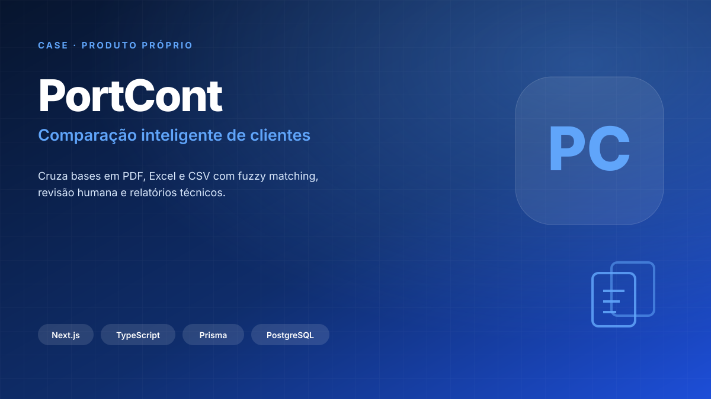

# PortCont

**Comparação inteligente de bases de clientes**  
`Produto próprio` · `Dados` · `No ar` · 2026

**Acesso:** [portcont.vercel.app](https://portcont.vercel.app) — ambiente interno com login.

## Contexto

Comparar duas bases de clientes manualmente é lento e sujeito a erro. Nomes com variações de escrita, bases em formatos diferentes e registros duplicados fazem com que uma conciliação simples vire uma planilha enorme de conferência.

## Solução

Uma aplicação web que recebe arquivos PDF, XLSX, XLS e CSV, extrai os clientes e compara as bases. O sistema separa quem está nas duas bases, quem está apenas na base A, quem está apenas na base B e quais nomes são semelhantes o suficiente para exigir revisão humana.

## O que foi feito

- Upload e leitura de PDF, XLSX, XLS e CSV.
- Normalização dos registros para comparação.
- Fuzzy matching para variações de escrita.
- Classificação em existentes, exclusivos e semelhantes.
- Revisão humana dos casos ambíguos.
- Gestão de parceiras, períodos e equivalências.
- Geração de relatórios e exportação.
- Autenticação com sessão protegida por cookie HttpOnly.

## Stack

- **Frontend:** Next.js 14, React 18 e TypeScript.
- **Backend:** Express, TypeScript e ES Modules.
- **Banco:** PostgreSQL no Neon.
- **ORM:** Prisma.
- **Deploy:** Vercel.
- **Testes:** Vitest.

## Status

No ar, em ambiente interno com login. O código e as bases de clientes são privados.
