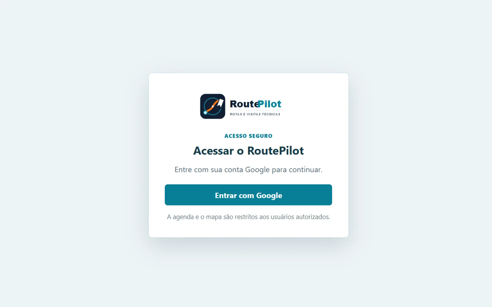

# RoutePilot

**Mapa operacional e planejamento de visitas técnicas**  
`Produto próprio` · `PWA` · `No ar` · 2026

*Tela de acesso real do produto. Agenda e mapa são restritos a usuários autorizados.*

**Acesso:** [routpilotes.vercel.app](https://routpilotes.vercel.app) — login Google restrito.

## Contexto

Equipes de campo precisam localizar um atendimento, entender a região, consultar referências e planejar a ordem das visitas. Em cidades com muitas localidades rurais e bairros com nomes parecidos, um mapa genérico não resolve a operação.

## Solução

Uma PWA de consulta geográfica operacional e planejamento de visitas. O sistema combina uma base local de endereços e regiões com mapa interativo, busca sem dependência de acentos, identificação de região por polígono e cálculo de rotas pela malha viária local.

## O que foi feito

- Mapa interativo com Leaflet e OpenStreetMap.
- Navegação por cidade, região, bairro e localidade rural.
- Busca fuzzy e geocodificação híbrida: base local, Photon e Geoapify opcional.
- Consulta de endereços locais e conferência opcional no Google Maps.
- Identificação de região com point-in-polygon e consulta de regiões próximas.
- Comparação de endereços e planejamento de rota com 2 a 24 locais.
- Reordenação manual, posições fixas e ordem sugerida.
- Anotações operacionais com revisão e validação.
- PWA instalável, operação offline com IndexedDB, modo escuro e impressão em A4.

## Cobertura atual

- 5 cidades.
- 11 regiões operacionais.
- 105 localidades e pontos cadastrados.
- 122.919 endereços integrados para consulta local.

## Stack

- HTML, CSS e JavaScript modular.
- Leaflet e OpenStreetMap.
- IndexedDB e Service Worker.
- Netlify, Netlify Identity com login Google e Neon PostgreSQL.
- Funções serverless para geocodificação e sincronização.

## Status

No ar, com acesso restrito a usuários autorizados. O código é privado.
