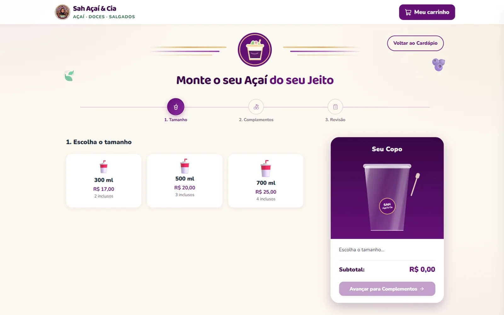

# Sah Açaí & Cia

**Sistema de pedidos pelo WhatsApp e painel financeiro**  
`Cliente real` · `Food retail` · `Full-stack` · 2026

*Produto real da loja. A imagem faz parte do catálogo da Sah Açaí & Cia.*

<strong>Ver o sistema por dentro</strong>

*Montagem do copo: tamanho, complementos e revisão do pedido.*

*Acesso ao painel administrativo da operação.*

## Contexto

A Sah Açaí & Cia precisava receber pedidos personalizados sem depender de um marketplace ou de um checkout complicado. O cliente monta o copo, escolhe complementos, informa endereço e finaliza pelo WhatsApp. A loja precisava que o pedido chegasse validado e que o valor fosse calculado no servidor, não no navegador.

## Solução

Um sistema full-stack com vitrine, montagem de pedido, checkout com endereço e painel administrativo. O backend valida o catálogo, recalcula cada item e registra o pedido antes de devolver o link do WhatsApp. O painel reúne dashboard financeiro, pedidos do site, lançamentos manuais de outros canais e acompanhamento de custos e embalagens.

## O que foi feito

- Catálogo e regras comerciais modelados no backend.
- Montagem de copos com complementos gratuitos e adicionais pagos.
- Checkout com nome, WhatsApp, endereço, complemento e observações.
- Registro do pedido no banco antes de abrir a conversa no WhatsApp.
- Painel administrativo com dashboard financeiro e inclusão manual de pedidos.
- Cálculo de copos, colheres e sacolas no servidor.

## Stack

- **Frontend:** React, TypeScript, Vite e Tailwind.
- **Backend:** Node.js, Express, TypeScript e Prisma.
- **Banco:** PostgreSQL.
- **Integração:** WhatsApp por deep link, sem gateway de pagamento.

## Status

Sistema privado, desenvolvido para uma operação real. O código não é público e os dados da loja não são expostos.
